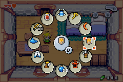
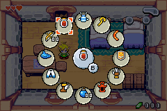
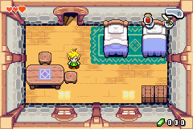

# The Minish Cap — Radial Item Menu (GBA, EU)

Cambia de ítem sin entrar al menú de pausa. Mantén **L** y aparece un menú radial con todos tus ítems; el juego se congela mientras eliges.

*Switch items without opening the pause menu. Hold **L** for a radial menu with all your items; the game freezes while you pick. (English below.)*

| Menú radial | Elegir | Resultado |
|---|---|---|
|  |  |  |

## Descarga

Descarga el `.bps` desde **[Releases](../../releases)** o desde la carpeta [`patch/`](patch/).

## Controles

| Botón | Acción |
|---|---|
| **L** (toque) | Fusión de kinestones, igual que siempre |
| **L** (mantener) | Abre el radial y pausa el juego |
| **D-pad** | Apunta al ítem |
| **R** (con L) | Avanza un ítem en sentido del reloj |
| **Soltar L** | Equipa el ítem en **B** (la espada siempre en **A**). Si no moviste nada, no cambia nada |
| **B / START** (con L) | Cerrar sin cambios |

- El menú crece conforme consigues ítems (mismo orden que el menú de pausa) e incluye el escudo.
- Botellas: un solo espacio; equipa la primera con contenido.
- Gráficos con las paletas originales del juego.
- **Compatible con partidas guardadas** (.sav/.srm): puedes parchar a media partida. Los *save states* del emulador **no** son compatibles; guarda dentro del juego antes de parchar.

## ROM base

| | |
|---|---|
| Juego | Legend of Zelda, The - The Minish Cap (Europe) (En,Fr,De,Es,It) — No-Intro |
| CRC32 | `E8637292` |
| SHA-1 | `CFF199B36FF173FB6FAF152653D1BCCF87C26FB7` |
| SHA-1 parchada | `60C1ACB6D9DB6660C2C95230389FD7BF1181248E` |

Aplica el parche con [Rom Patcher JS](https://www.marcrobledo.com/RomPatcher.js/), [Floating IPS](https://www.smwcentral.net/?p=section&a=details&id=11474), o con *soft-patching* en RetroArch/mGBA (mismo nombre de archivo que la ROM). Probado en mGBA (core libretro).

**No se distribuye ninguna ROM.** Necesitas tu propia copia legal del juego.

---

## English

| Button | Action |
|---|---|
| **L** (tap) | Kinstone fusion, as usual |
| **L** (hold) | Opens the radial menu, game pauses |
| **D-pad** | Point at an item |
| **R** (with L) | Step one item clockwise |
| **Release L** | Equip on **B** (sword always stays on **A**). No input = no change |
| **B / START** (with L) | Close without changes |

Works with existing in-game saves; emulator save states are not compatible. Requires the **European** ROM (hashes above).

## Cómo funciona / How it works

The hack is written in C on top of the symbols of the [zeldaret/tmc](https://github.com/zeldaret/tmc) decompilation. The compiled code is placed in free space at the end of the ROM, and the **only** change to the original game is one pointer in `GameTask_Main`'s state table (`GameMain_Update` → `Radial_GameMainUpdate`), so nothing in the original ROM is shifted.

- While open, the last game frame's OAM is replayed under the menu (frozen sprites), BGs/sprites are dimmed with BLDY and the menu sprites use semi-transparent mode with EVA=16 so they stay at full brightness.
- Menu graphics use the fixed OBJ palettes 0/3/4; tiles are borrowed from free GFX slots and restored on close.
- State lives in unused EWRAM (`0x0203E000`, past `gEndOfEwram`).

### Build

1. Build the EU ROM from [zeldaret/tmc](https://github.com/zeldaret/tmc) (`make eu`, needs `baserom_eu.gba`) next to this repo (or set `TMC=/path/to/tmc`).
2. `cd src && ./build.sh` (needs `arm-none-eabi-gcc`, Python 3 + Pillow).
3. `python3 bps.py ../../tmc/baserom_eu.gba zelda_radial_eu.gba out.bps`

## Créditos / Credits

- **Ketzergon** — concepto, diseño, pruebas
- **[zeldaret/tmc](https://github.com/zeldaret/tmc)** — decompilación de The Minish Cap

The Legend of Zelda: The Minish Cap © Nintendo / Capcom. Este proyecto no está afiliado a Nintendo.
